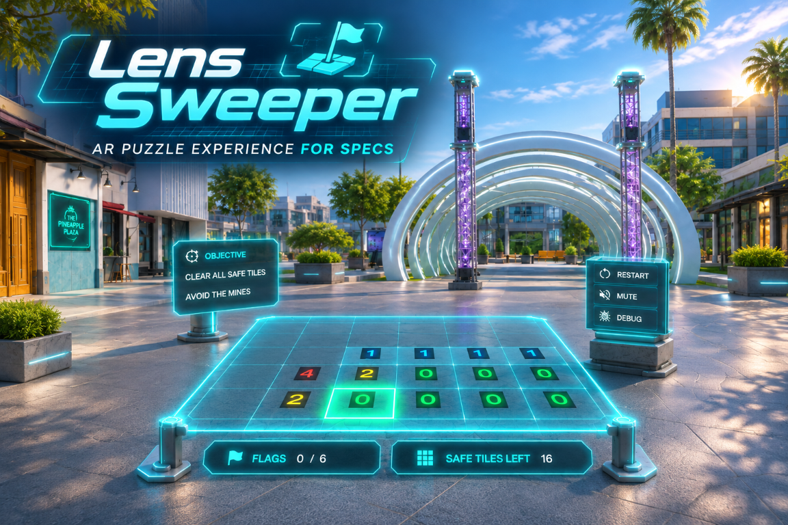

# Lens Sweeper

**Your floor is the minefield.** Lens Sweeper is a room-scale, augmented-reality Minesweeper game for **SPECS**, built with Lens Studio and TypeScript. Walk onto tiles to reveal clues, mark suspected mines with red flags, and clear every safe tile.

*The banner above is promotional artwork, not an in-device screenshot.*

## Gameplay

1. Choose a difficulty on the intro panel.
2. Look toward a clear floor area and use **PLACE** to position the board.
3. Press **START**, then physically enter the board to reveal your first tile.
4. Read each revealed number: it counts mines in the eight surrounding cells. Empty tiles flood-reveal connected empty areas and their numbered boundaries.
5. Use hand interaction on an unrevealed tile to toggle a flag. Flagged tiles are ignored when entered; remove the flag to reveal one.
6. Reveal all safe tiles to win. Entering an unflagged mine ends the round.

The first entered tile **and its neighbors are protected** from mine placement. Flags are optional markers, not a separate win condition.

Play in an unobstructed space with enough room for the entire board and safe movement around it. AR flags do not indicate real-world hazards.

## Features

- Floor-aligned world-space board using World Query surface detection on device.
- The room-scale arena has low cyan perimeter rails, four faceted corner posts, a stronger floor grid, and subtle mint insets for revealed empty cells. The architecture uses seven merged meshes and one shared inset mesh.
- Full-size floor cells pulse their corners and scan across the pavement before the spatial clue rises. Extruded numbers continue to face the player.
- Red pennants deploy and retract, then wave continuously with a pinned mast seam and a deforming cloth mesh.
- Only the struck mine materializes as a faceted studded sphere, then breaks into eight pooled pieces and four brief sparks. One floor ring fades to a crossed-circle marker; other mines use small coral floor pins instead of red tile fills.
- The result card follows after 0.95 seconds. It is compact, lifted above the view center and world anchored, with a cleared-tile summary, concise stats and one cyan replay action. Wins send a mint floor sweep.
- Extruded clue numbers face the player; empty tiles use quiet floor markers.
- Spatial objective, controls, and counter panels built with UIKit, with larger arena text, soft border rims, and matching console supports. Their positions adapt to the selected board footprint.
- Timer, step count, flag count, and remaining-safe-tile tracking.
- Three difficulty presets, with locally saved difficulty selection, best times, and win counts.
- Background music, gameplay sound effects, victory animation, and mine-hit effects.
- Preview-only movement and debugging controls for testing without walking.

### Difficulty

| Mode | Grid | Mines | Tile size | Board footprint |
|---|---|---|---|---|
| Easy | 5 × 5 | 4 | 44 cm | 2.2 × 2.2 m |
| Standard | 6 × 6 | 6 | 50 cm | 3 × 3 m |
| Expert | 7 × 7 | 10 | 42 cm | 2.94 × 2.94 m |

Standard is the default when no difficulty has been saved. Footprints describe the grid only; allow additional space for the surrounding UI and movement.

## Getting started

### Requirements

- **Lens Studio 5.24.1**, the version recorded in the project manifest.
- **SPECS** for physical movement, hand interaction, and on-device floor-placement testing.
- The project's included packages, notably the interaction kit, UIKit, and LEAF test framework.

This is a Lens Studio project, not a browser or Node.js application. There is no npm installation or development-server step.

### Open and preview

1. Clone or download this repository.
2. Open [Map Pointer.esproj](Map%20Pointer.esproj) in Lens Studio.
3. Allow Lens Studio to import assets, resolve packages, and compile scripts.
4. Run Preview with the authored [scene](Assets/Scene.scene).
5. Choose a mode and press **START**.
6. Open **DEBUG** to access simulated movement. Starting a round does not automatically reveal a simulated tile; press a movement button to enter one.

The project filename is inherited from its original template. The game is **Lens Sweeper**; source identifiers still use `StepSweeper`, and some in-game labels and logs currently use `Specs Sweeper`.

### Preview controls

| Control | Action |
|---|---|
| **NORTH / SOUTH / WEST / EAST** | Move the simulated player by one cell |
| **TARGET** | Cycle through unrevealed tiles |
| **FLAG** | Toggle a flag on the targeted tile |
| **MINES** | Toggle debug mine visibility |
| **WIN / LOSS** | Force an end state to inspect feedback |
| **RESTART / PLAY AGAIN** | Start a new round |
| **RECENTER** | Reposition the board |
| **MUTE / UNMUTE** | Toggle background music; gameplay effects remain audible |

Simulated movement is enabled only in the editor when `useSimulatedPlayer` is enabled. Debug-forced wins do not update persistent records.

### Run on SPECS

Use Lens Studio's device pairing and Lens delivery workflow to run the project on SPECS. Choose a clear play area, look toward the floor, and select **PLACE** or **RECENTER**.

On device, placement uses World Query to find an upward-facing surface. **FLOOR LOCKED** indicates a successful hit. If the panel displays **NO FLOOR — LOOK DOWN & RETRY**, look down and retry placement before playing.

Preview places the board center 340 cm forward and uses a fixed world floor height (`emulatorFloorY`, default −170 cm for Sunlit Outdoor). Moving the camera vertically does not change the floor when restarting or recentering. Reset the Interactive Preview camera before beginning a new demo; other environments may need a different floor height in the Inspector. On device, World Query supplies the real floor.

## Code overview

Gameplay rules are separated from scene presentation and interaction:

| Source | Responsibility |
|---|---|
| [StepSweeperMain.ts](Assets/Scripts/StepSweeperMain.ts) | Lifecycle, component wiring, round flow, queued reveals, and UI actions |
| [StepSweeperBoardManager.ts](Assets/Scripts/StepSweeperBoardManager.ts) | Grid data, seeded mine placement, adjacency, and cell positions |
| [StepSweeperCellData.ts](Assets/Scripts/StepSweeperCellData.ts) | Cell state and entry rules |
| [StepSweeperRevealSystem.ts](Assets/Scripts/StepSweeperRevealSystem.ts) | Flood-fill reveal order |
| [StepSweeperPlayerGridTracker.ts](Assets/Scripts/StepSweeperPlayerGridTracker.ts) | World-to-grid conversion and cell-entry transitions |
| [StepSweeperFlagInteraction.ts](Assets/Scripts/StepSweeperFlagInteraction.ts) | View-based targeting and flag rules |
| [StepSweeperFloorPlacement.ts](Assets/Scripts/StepSweeperFloorPlacement.ts) | World Query placement and Preview positioning |
| [StepSweeperCellViewUI.ts](Assets/Scripts/StepSweeperCellViewUI.ts) | Runtime board visuals, tile interaction, flags, and effects |
| [StepSweeperGameUI.ts](Assets/Scripts/StepSweeperGameUI.ts) | Intro, spatial HUD, debug controls, and end panels |
| [StepSweeperGameState.ts](Assets/Scripts/StepSweeperGameState.ts) | Round phase, timing, steps, and generation |
| [StepSweeperProgress.ts](Assets/Scripts/StepSweeperProgress.ts) | Difficulty presets, local records, and scoring |
| [StepSweeperAudioController.ts](Assets/Scripts/StepSweeperAudioController.ts) | Music and gameplay audio |

### Project layout

- [Assets/Scene.scene](Assets/Scene.scene): authored scene and component references.
- [Assets/Scripts/](Assets/Scripts/): gameplay and presentation TypeScript.
- [Assets/Scripts/Tests/](Assets/Scripts/Tests/): LEAF integration scenarios and interaction helpers.
- [Assets/GeneratedSFX/](Assets/GeneratedSFX/): music and gameplay audio.
- [Assets/Materials/](Assets/Materials/), [Assets/Meshes/](Assets/Meshes/), and [Assets/Icons/](Assets/Icons/): visual resources.
- [Assets/Documentation/](Assets/Documentation/): README banner.
- [Packages/](Packages/): Lens Studio packages.

Lens Studio generates local caches and support definitions. Do not edit generated cache files.

## Configuration

Edit the presets in [StepSweeperProgress.ts](Assets/Scripts/StepSweeperProgress.ts) to change grid dimensions, mine counts, tile sizes, or score multipliers. The selected preset overwrites the board-size and mine-count inputs on the main component at startup.

The main component's Inspector inputs control board distance, Preview floor offset, simulated movement, reveal-animation delay, and diagnostic logging. Keep its board root, tracked camera, board view, and game UI references wired to the authored scene.

World distances are in **centimeters**. Runtime rotations use **radians**. Scripts run in the Lens runtime, not a browser DOM.

## Testing

The project registers five LEAF scenarios in [StepSweeperLeafIndex.ts](Assets/Scripts/Tests/StepSweeperLeafIndex.ts). Use the LEAF runner in Lens Studio with the project scene loaded:

| Scenario ID | Coverage |
|---|---|
| `specssweeper-start-reachability` | Start button reaches the gameplay HUD |
| `specssweeper-core-flow` | Flag rules, floor-scan cleanup, depth-tested floor marks, spatial clues, compact win/loss cards, replay and localized mine-hit effects |
| `specssweeper-progression-placement` | Local record storage, difficulty board rebuilding, and Preview recentering |
| `specssweeper-flag-motion` | Pinned seam and moving cloth tip, interrupted deployment/retraction, restart during a burst; leaves a planted flag for review |
| `specssweeper-effects-render` | Production burst and result-state visual inspection. Default sequence removes its fixture. Optional `pose` values `mine`, `burst-032`, `burst-060`, `win`, and `loss` leave a state for capture until Preview resets. |

Run UI scenarios from a fresh Preview session. The core-flow scenario assumes **Standard** difficulty and simulated movement; select Standard before running it. Progression and reachability scenarios expect the intro screen.

These scenarios do not replace testing floor detection, physical movement, hand targeting, and spatial readability on SPECS.

## AI development with CLAD

This project includes [CLAD](https://developers.specs.com/docs/clad), the Lens Studio agent toolkit, ported to GitHub Copilot. The port includes skills, custom agents, and a Lens Studio liveness hook:

- [.github/skills/](.github/skills/): the 56 ls-clad skills. Start Lens Studio tasks with `/lens-studio-router`.
- [.github/agents/](.github/agents/): ls-clad subagents such as `specs-experience-builder` and `live-lens-tester`.
- [.github/hooks/lens-studio-liveness.json](.github/hooks/lens-studio-liveness.json): blocks Lens Studio tool calls when the editor is closed.

Open this project in Lens Studio **before** starting a Copilot session. Lens Studio provides the `lens-studio` MCP server and writes its local connection files (`.vscode/mcp.json`, `.mcp.json`).

To update the toolkit from [ls-extensions](https://github.com/lens-studio-devs/ls-extensions), run:

```sh
python3 .github/clad/sync-clad.py
```

The script records the upstream commit in [.github/clad/manifest.json](.github/clad/manifest.json). Do not edit generated skills or agents directly. Claude Code, Codex, and Cursor can install the `ls-clad` plugin directly instead.
